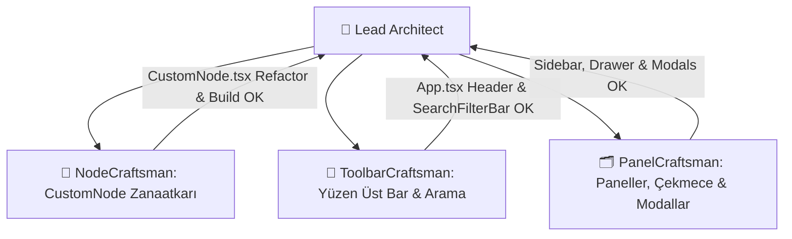

# 🚀 Oturum Günlüğü: 2026-10-18 - Frontend UI/UX Overhaul & Tactile Craftsmanship

## 🎯 Oturumun Amacı
NetWork uygulamasını "AI slop" olarak bilinen genel-geçer şablon arayüzden çıkarıp; Linear, Raycast ve Figma kalitesinde özgün, taktil, tutarlı ve dokunsal bir tuval ortamına dönüştürmek.

---

## 👥 Alt-Ajan Orkestrasyonu (Modular Architect Pipeline)

### 1. Temel & İkon Altyapısı (Phase 1)
- `lucide-react` paketi kuruldu.
- `client/src/constants/designTokens.ts` oluşturuldu; türler (`kisi`, `kurum`, `kavram`, `diger`), rozetler, renk kodları ve Lucide simgeleri merkezileştirildi.
- `client/src/index.css` içine `.glass-panel`, `.glass-floating`, `.tactile-card`, `.btn-tactile` sınıfları ve şık scrollbar eklendi.

### 2. `NodeCraftsman` ile CustomNode Dönüşümü (Phase 2)
- Emojiler temizlendi, `User`, `Building2`, `Lightbulb`, `Component` ve durum ikonları bağlandı.
- Dinamik monogram avatarlar ve 4 yönlü 5'er slotlu mikro iğne ucu bağlantı noktaları (pin handles) yerleştirildi.

### 3. `ToolbarCraftsman` ile Yüzen Ada Toolbar (Phase 3)
- Klasik üst şerit kaldırılıp yüzen cam adacıklar (floating glass islands) mimarisine geçildi.
- Raycast tarzı `SearchFilterBar` (`⌘F` kısayol rozeti, temizleme butonu, dinamik tip dropdown'u) inşa edildi.

### 4. `PanelCraftsman` ile Paneller ve Modallar (Phase 4 & 5)
- `SidebarPanel.tsx`: Harita kartlarında taktil derinlik ve aktif radyal belirteçler.
- `NodeDetailDrawer.tsx`: Düğüm müfettişi (inspector) standartlarına yükseltildi.
- `NodeModal.tsx`, `EdgeModal.tsx`, `MapModal.tsx`, `NetworkInsightsModal.tsx`, `ShortcutsModal.tsx`, `ImportExportModal.tsx`: Tüm emojilerden arındırılıp vektörel ikonlar ve cam pencerelere uyarlandı.
- `GraphCanvas.tsx`: Boş harita ve boş düğüm durumları minimalist vektörel illüstrasyonlarla donatıldı.

---

## 🧪 Doğrulama Kapıları (Verification Gates)
- **Frontend Build (`npm run build`):** 0 hata (`dist/` 144ms içinde derlendi).
- **Frontend Lint (`npm run lint`):** 0 hata, 0 uyarı.
- **Backend Tests (`npm test`):** 18 test dosyası, 143 testin 143'ü de BAŞARILI.

---

## 🔗 İlgili Kaynaklar
- [[Frontend UI UX Overhaul and Design Tokens]] (ADR 0005)
- [[Backend Resilience and Validation Strategy]] (ADR 0004)
- [[00_Index]]
